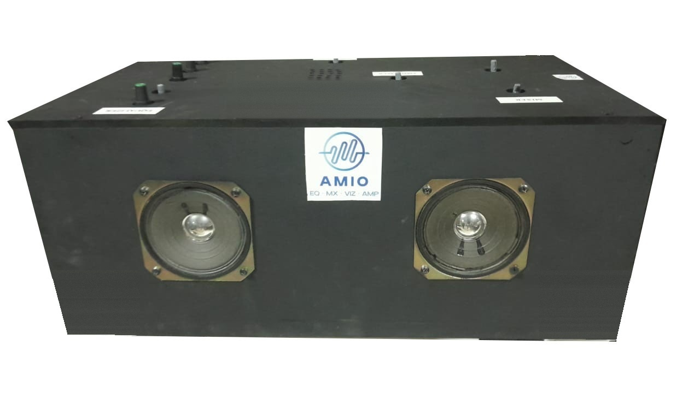
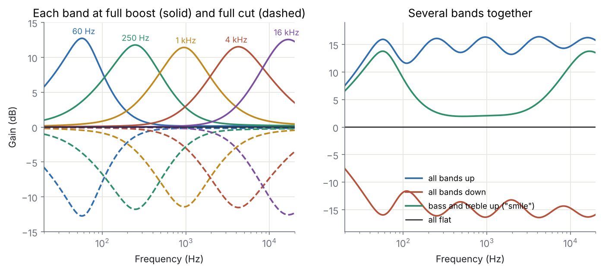
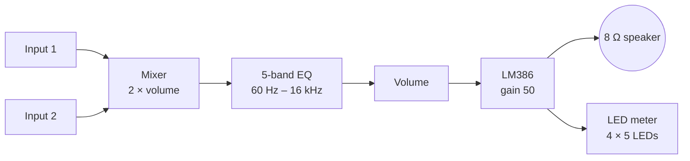
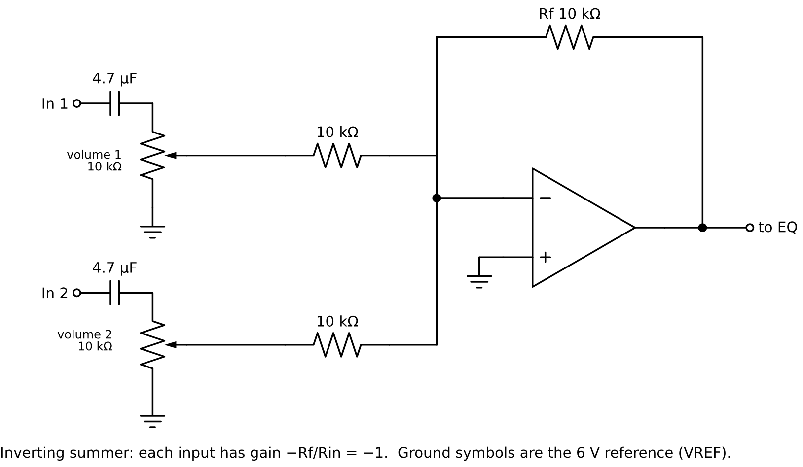
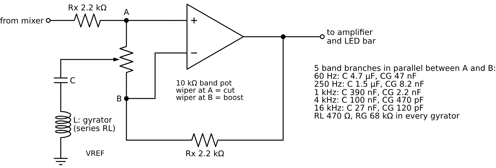
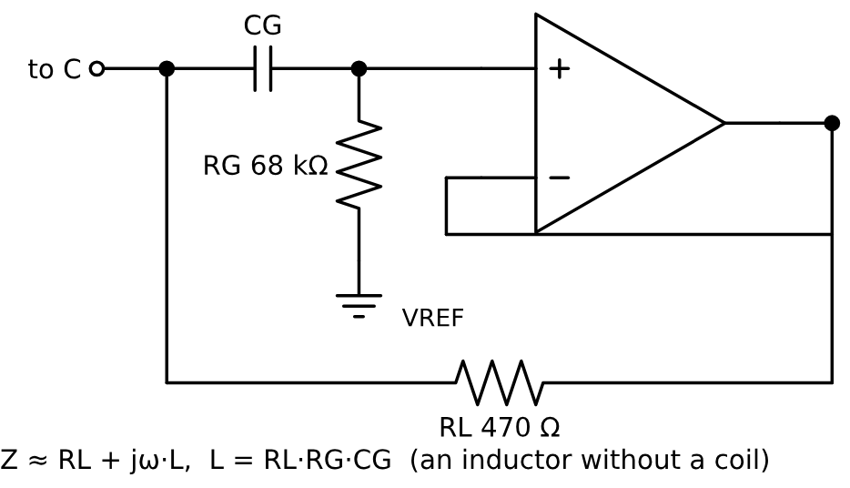
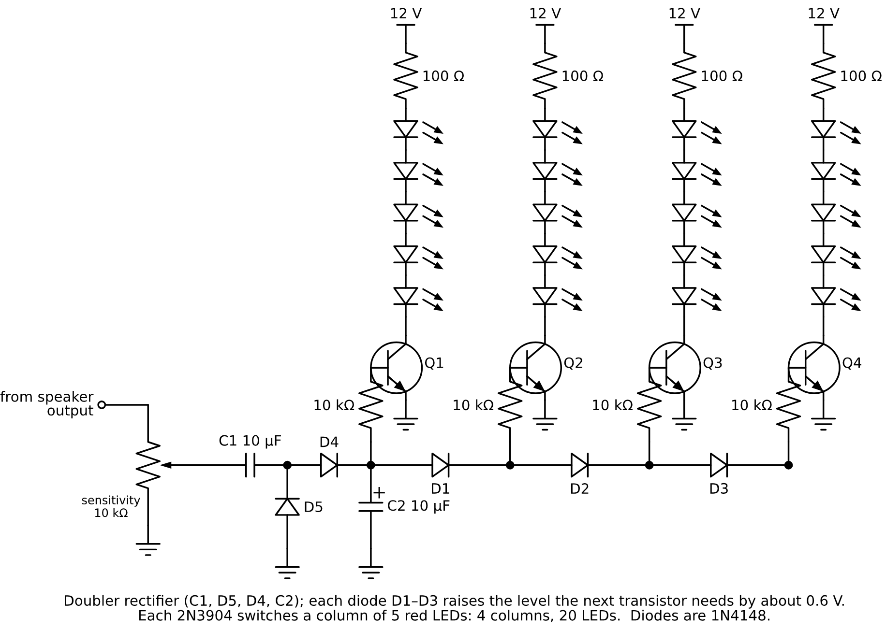
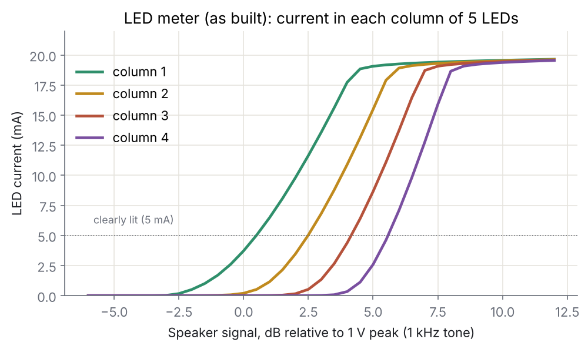
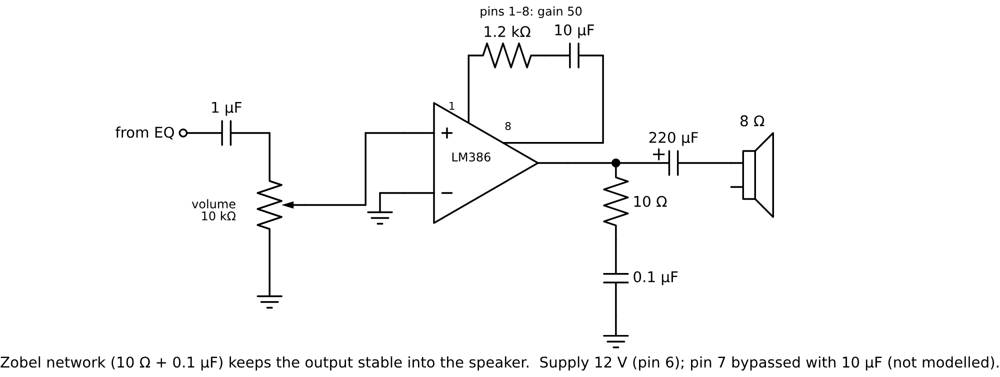
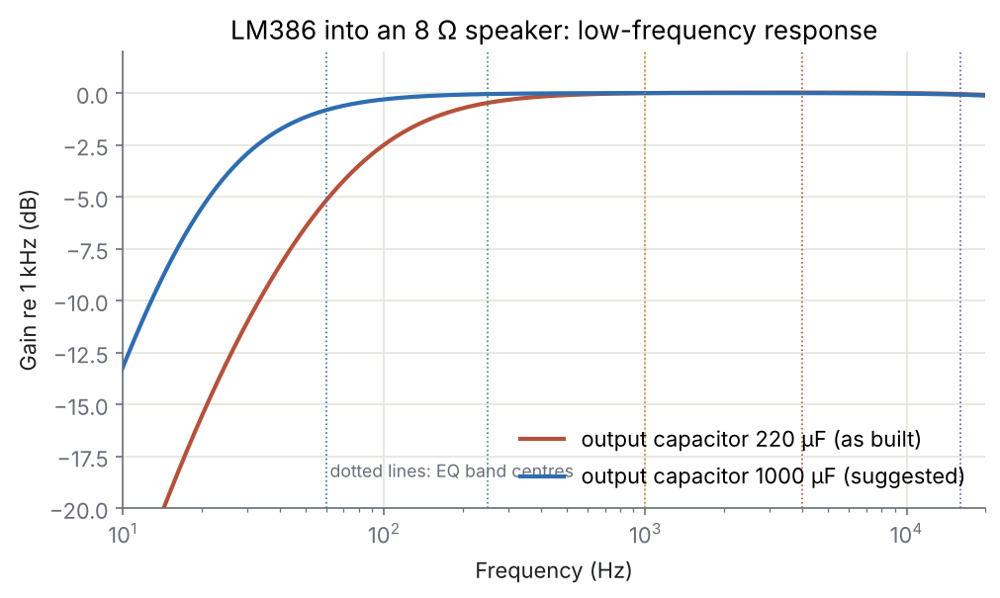

# Analog Audio Processor: Mixer, 5-Band EQ, LED Meter, Amplifier (SPICE)

A four-stage analog audio system on a single 12 V supply: a 2-input mixer, a 5-band graphic equalizer, a 20-LED level meter and an LM386 speaker amplifier. Each stage is drawn as a schematic, simulated in SPICE (ngspice) and checked by automated tests.

**Built:** August 2024 · based on a Circuit Analysis II lab project (Summer 2024)

<p align="center">
  
</p>

**Demo video:** [media/demo_build.mp4](media/demo_build.mp4), the system playing music from a phone while the PCBs were being wired into the enclosure.

The unit built for the course has two mixer knobs, five equalizer knobs, a visualizer knob with a 20-LED meter, an amplifier volume knob and two speakers, with hand-etched PCBs inside. This repository models the same panel:

| Stage | In this repository | Compared with the build |
| --- | --- | --- |
| Mixer | 2-input op-amp summing amplifier | Redesigned (the build used an LM3900 current-mode amplifier) |
| Equalizer | Single op-amp, 5 bands with gyrators: 60, 250, 1k, 4k, 16k Hz | Redesigned (the build used an LA3600 equalizer IC, now discontinued and without a SPICE model); same 5 bands |
| LED meter | Doubler rectifier, diode ladder, 4 transistors × 5 LEDs | The build's circuit, simulated as built |
| Amplifier | LM386, gain 50, Zobel network, 220 µF output capacitor | The build's circuit, simulated as built |

Every number below comes from simulation, not from measurements on the unit.

## Results

| Stage | Result (simulated) |
| --- | --- |
| Mixer | Unity gain per input (0.00 dB at 1 kHz); inputs add correctly (0.5 V + 0.5 V = 1.0 V); −0.5 dB at 20 Hz |
| Equalizer | 5 bands, each ±11.4 to ±12.7 dB; boost and cut mirror each other within 0.01 dB; flat (0.001 dB) with all pots centred |
| Equalizer headroom | 0.73 V rms input at full 60 Hz boost before the op-amp clips: a standard line-level signal fits |
| LED meter | Columns light (5 mA) at 1.06, 1.33, 1.68 and 2.0 V peak on the speaker; full brightness 19.6 mA per column at 12 V |
| LED meter supply | 5.1 mA at 10 V (dim), 44 mA at 15 V (over the usual 20 mA LED rating); 270 Ω instead of 100 Ω gives 18.5 mA at 15 V |
| Amplifier | Gain 47 (33.4 dB) into 8 Ω; low cut-off 89 Hz with the 220 µF output capacitor, 29 Hz with 1000 µF |
| Whole chain | Input to speaker: 33.4 dB gain, within 1.3 dB from 50 Hz to 20 kHz with the EQ flat (1000 µF output capacitor) |

<p align="center">
  
</p>

| Band | C | CG (gyrator) | Simulated inductance | Peak at | Boost / cut |
| --- | --- | --- | --- | --- | --- |
| 60 Hz | 4.7 µF | 47 nF | 1.50 H | 57 Hz | ±12.7 dB |
| 250 Hz | 1.5 µF | 8.2 nF | 0.26 H | 247 Hz | ±11.8 dB |
| 1 kHz | 390 nF | 2.2 nF | 70 mH | 952 Hz | ±11.4 dB |
| 4 kHz | 100 nF | 470 pF | 15 mH | 4.26 kHz | ±11.5 dB |
| 16 kHz | 27 nF | 120 pF | 3.8 mH | 16.8 kHz | ±12.6 dB |

All values are standard E12 parts, chosen by `analysis/circuits.py` to land closest to each target frequency with a Q between 0.8 and 1.25. The peaks fall within 7 % of the targets.

## How it works



Everything runs from one 12 V supply (the build's parts list gives 10–15 V). A buffered divider makes a 6 V reference (VREF), and the op-amp stages swing around it.

**Mixer.** Each input passes a coupling capacitor and a volume pot, then a 10 kΩ resistor into the summing node of an inverting amplifier with 10 kΩ feedback. Each input has a gain of −1 and the output is their sum.

<p align="center"></p>

**Equalizer.** A single op-amp with five band branches between its two inputs.
- Each branch is a pot whose wiper feeds a series LC circuit to VREF.
- At its resonant frequency the LC circuit has very low impedance. With the wiper at the input side (A) it shunts the input signal: cut. At the feedback side (B) it shunts the feedback: boost.
- With the wiper centred the two effects cancel, so the response is flat.
- Boost and cut are symmetric because both sides use the same 2.2 kΩ resistor.

<p align="center"></p>

**Gyrators.** The 60 Hz band needs 1.5 H, which would be a large coil that picks up hum. A gyrator makes the same impedance from an op-amp, a capacitor and two resistors: L = RL·RG·CG, with RL in series. RL (470 Ω) also sets the boost and cut range.

<p align="center"></p>

**LED meter (as built).**
- The speaker signal goes through the sensitivity pot (the visualizer knob) into a voltage doubler (C1, D5, D4, C2), which turns it into a DC level of about twice its peak.
- That level drives four transistors through a chain of diodes (D1–D3). Each diode adds about 0.6 V, so each next transistor needs a louder signal.
- Each transistor switches a column of 5 red LEDs in series with 100 Ω from the supply: 4 columns, 20 LEDs.

<p align="center"></p>
<p align="center"></p>

**Amplifier (as built).** An LM386 with 1.2 kΩ + 10 µF between pins 1 and 8 (gain 50) drives the speaker through a 220 µF capacitor that blocks the DC on its output. A Zobel network (10 Ω + 0.1 µF) keeps it stable into the speaker's inductive load.

<p align="center"></p>

## Engineering notes

- **Output capacitor size.** The output capacitor and the 8 Ω speaker form a high-pass filter, f = 1/(2π·R·C). With the build's 220 µF that is 89 Hz, so the 60 Hz band loses 5.2 dB before the EQ can do anything. 1000 µF moves it to 29 Hz (−0.8 dB at 60 Hz).
  <p align="center"></p>
- **LED meter and supply voltage.** Five red LEDs in series need about 9.8 V, so with 100 Ω per column the LED current depends strongly on the supply: 5 mA at 10 V (dim), 19.6 mA at 12 V, 44 mA at 15 V, which is over the usual 20 mA rating. Either keep the meter on 12 V or use 270 Ω (18.5 mA at 15 V).
- **LED meter range.** Each diode in the ladder adds a fixed 0.6 V, so the four columns light between 1.06 V and 2.0 V peak: the whole meter covers only about 6 dB of loudness, and a column fades in gradually rather than switching on. Comparators with thresholds spaced in dB would cover a wider range.
- **Gain staging.** The LM386 output swings about ±5 V on 12 V, so at gain 50 it clips at 0.1 V peak input; the volume pot sets how much line-level signal reaches it. At gain 200 (10 µF alone across pins 1–8) it would clip at 25 mV.
- **Bands interact.** Raising all five EQ bands does not give a flat +12 dB: neighbouring bands overlap, so the response ripples between +7.6 and +16.4 dB. That is normal for a graphic equalizer.

## Repository layout

```
spice/
  models.lib            op-amp, LM386, gyrator, 2N3904, 1N4148 and LED models
  mixer.cir, eq.cir,    standalone ngspice netlists of each stage
  visualizer.cir, amp.cir
analysis/
  circuits.py           component selection (E12), netlists, ngspice runner
  run_all.py            runs every simulation, writes media/*.png, results.json and spice/*.cir
  schematics.py         draws the schematics (schemdraw)
tests/test_circuits.py  12 checks on the simulated circuits
results.json            all simulated numbers
media/                  build photo, demo video, schematics, plots
```

## Run it

Python 3.10+ with `numpy`, `matplotlib`, `pytest` (and `schemdraw` for the schematics), plus [ngspice](https://ngspice.sourceforge.io/) on the PATH.

```
pip install -r requirements.txt
python analysis/run_all.py     # simulations, figures, results.json (about 15 s)
pytest -q                      # 12 tests
ngspice spice/eq.cir           # any single stage, interactive plot
```

GitHub Actions runs the tests on every push.

## Limitations and next steps

- Simulation only: no measurements on the unit. The op-amp is a generic model (100 dB gain, 10 MHz bandwidth, outputs 1.5 V from the rails, no slew-rate limit), the LM386 is an idealised behavioural model, and the LED model is a generic red LED (about 1.95 V at 20 mA), so distortion, output power and exact LED brightness are not predicted.
- Component tolerances are not included. Next: a Monte Carlo run with 5 % capacitors and 1 % resistors to see how far the EQ bands move.
- Next: build the redesigned equalizer and measure it against these curves; replace the diode-ladder meter with dB-spaced comparators.

## Author

**Michel Salame** — [LinkedIn](https://www.linkedin.com/in/michel-salame)
